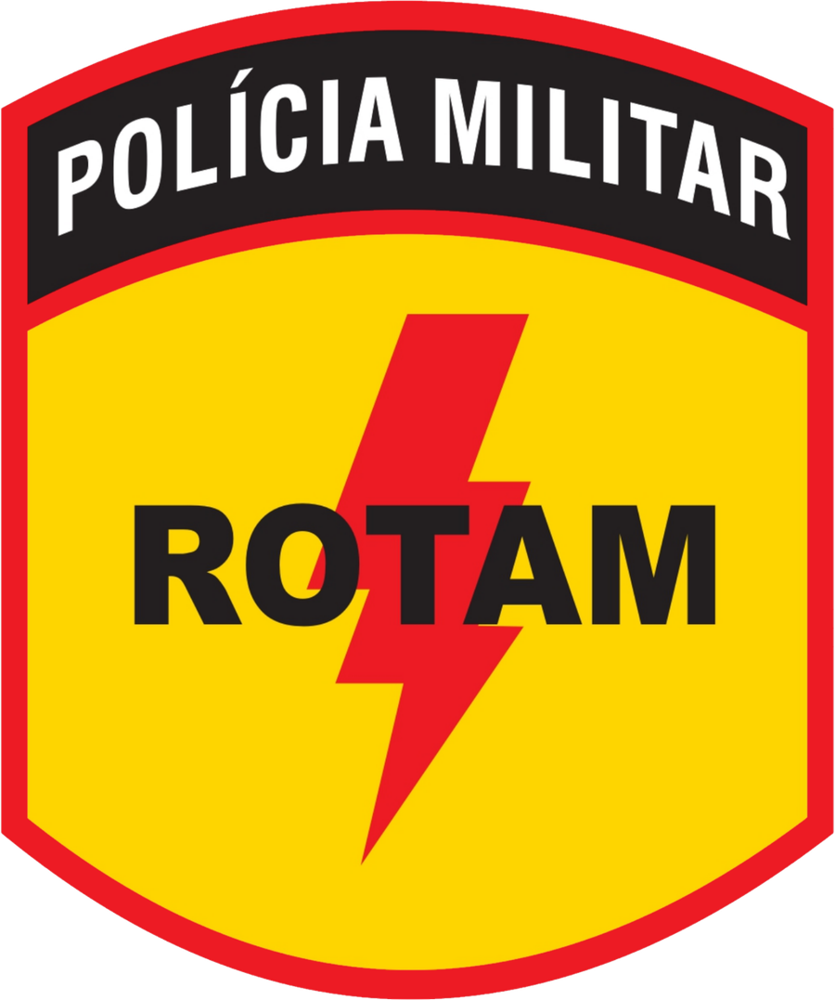

<div align="center">



# ROTAM GOIÁS · GTA RP

**Portal de portfólio do Batalhão de Rondas Ostensivas Táticas Metropolitanas no roleplay**

Notícias · Galeria de fotos · Painel administrativo com login

</div>

---

## ⚡ Sobre o projeto

Site público de portfólio da ROTAM no servidor de roleplay, com identidade visual construída a
partir do **brasão oficial** da unidade: ouro `#FED500`, vermelho `#ED1B24` e preto `#231F20`.

Qualquer visitante pode ler as notícias, abrir as matérias completas e navegar pela galeria de fotos.
Somente o administrador — com usuário e senha — pode publicar, editar e excluir conteúdo.

### Recursos

- **Home** com capa, destaques, últimas notícias, prévia da galeria e heráldica do brasão
- **Notícias** com busca, filtro por categoria e matéria completa ilustrada
- **Galeria** em mosaico, com filtros por categoria e visualizador em tela cheia (lightbox)
- **Sobre** com doutrina, significado das cores, linha do tempo e canais de contato
- **Área restrita** com login, painel, upload de imagens, troca de senha e registro de acessos
- **100% responsivo** (desktop, tablet e celular)
- Conteúdo **persistido em disco** — sobrevive a reinícios do servidor

---

## 🚀 Como rodar

```bash
# instalar dependências
npm install

# ambiente de desenvolvimento (http://localhost:3000)
npm run dev

# produção
npm run build
npm start
```

O servidor escuta em `0.0.0.0:3000` (ou na porta definida em `PORT`).

---

## 🔐 Acesso do administrador

| Campo  | Valor      |
| ------ | ---------- |
| Usuário | `admin`   |
| Senha   | `rotam123` |

> **Importante:** troque a senha no primeiro acesso em **Painel → Configurações → Senha do
> administrador**. A senha é gravada com hash `scrypt` e nunca em texto puro.

As credenciais iniciais também podem ser definidas pelas variáveis de ambiente `ADMIN_USER` e
`ADMIN_PASSWORD` **antes da primeira execução** (veja `.env.example`). Elas só são usadas quando a
conta ainda não existe.

Proteções já incluídas:

- Sessão assinada com HMAC-SHA256, válida por **12 horas**
- Bloqueio temporário após **8 tentativas** de login incorretas (10 minutos)
- Todas as rotas de escrita exigem token válido
- Upload limitado a imagens de até 12 MB, redimensionadas automaticamente

---

## 🗂️ Onde ficam os dados

| Caminho        | Conteúdo                                                     |
| -------------- | ------------------------------------------------------------ |
| `data/posts.json`     | Notícias (inclui rascunhos e destaques)                |
| `data/photos.json`    | Fotos da galeria                                       |
| `data/settings.json`  | Identidade do site e canais de contato                 |
| `data/access-logs.json` | Registro de visitas (últimas 2.000)                  |
| `data/admin.json`     | Usuário e hash da senha do administrador               |
| `data/secret.key`     | Chave usada para assinar as sessões                    |
| `uploads/AAAA-MM/`    | Imagens enviadas pelo painel                           |

Essas pastas são criadas automaticamente na primeira execução e não vão para o Git.
Se você apagar `data/`, o portal volta ao conteúdo inicial de demonstração.

---

## 🧱 Estrutura

```
server.ts                API Express + autenticação + uploads + Vite
seed.ts                  Conteúdo inicial (notícias, fotos e configurações)
src/
  App.tsx                Rotas e estado global (sessão, dados do portal)
  pages/                 Home, Notícias, Matéria, Galeria, Sobre
  components/            Cabeçalho, rodapé, hero, cards, UI
  components/admin/      Login, painel, editores de notícia/foto, acessos
  lib/                   Cliente da API, roteador, markdown, formatação
public/img/marca/        Brasão e ícones
public/img/galeria/      Fotos do acervo
```

### API

| Método | Rota | Acesso |
| ------ | ---- | ------ |
| `GET` | `/api/bootstrap` | público |
| `GET` | `/api/posts` · `/api/posts/:slug` | público |
| `POST` | `/api/visit` | público |
| `POST` | `/api/auth/login` | público |
| `GET` | `/api/auth/me` | admin |
| `GET/POST/PUT/DELETE` | `/api/admin/posts` | admin |
| `GET/POST/PUT/DELETE` | `/api/admin/photos` | admin |
| `POST` | `/api/admin/upload` | admin |
| `PUT` | `/api/admin/settings` | admin |
| `POST` | `/api/admin/password` | admin |
| `GET` | `/api/admin/logs` · `POST /api/admin/logs/clear` | admin |

---

## 🎨 Cores do brasão

| Cor | Hex | Uso |
| --- | --- | --- |
| Ouro | `#FED500` | fundo do escudo, destaques, títulos |
| Vermelho | `#ED1B24` | contorno, raio, alertas |
| Preto | `#231F20` | sigla ROTAM, faixa superior, fundo do site |
| Branco | `#FEFEFE` | inscrição "POLÍCIA MILITAR" |

---

## ⚠️ Aviso

Este é um projeto de **roleplay (GTA RP)**. A unidade apresentada é fictícia, inspirada na doutrina e
na heráldica da Polícia Militar de Goiás, **sem vínculo oficial** com a corporação real. As notícias
publicadas são conteúdo do servidor.
