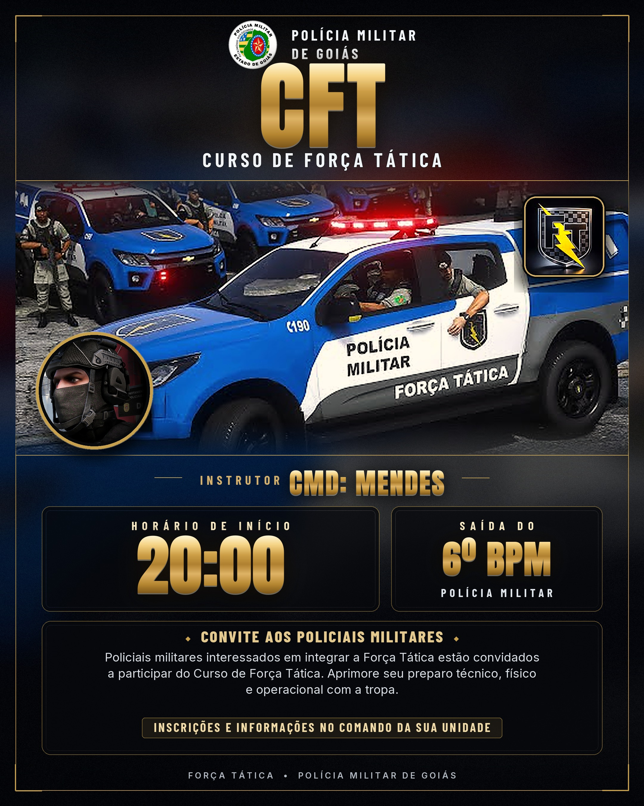

# Pôster — CFT · Curso de Força Tática (PMGO)

Peça de divulgação do **Curso de Força Tática (CFT)** da Polícia Militar de Goiás,
com o escudo da Força Tática, o brasão oficial da PMGO, a **viatura FT** como imagem
principal, o **retrato do instrutor** em medalhão no canto, o horário de início
(**20:00**), a **saída do 6º BPM** e um convite aos policiais militares interessados.



## Arquivos

| Arquivo | Uso | Especificação |
|---|---|---|
| `poster-cft-1080x1350.png` | Instagram / feed / grupos | 2160 × 2700 px (4:5), PNG sem perdas |
| `poster-cft-1080x1350.jpg` | Compartilhar no WhatsApp | JPG progressivo, qualidade 92 |
| `poster-cft-1080x1350.pdf` | Impressão rápida | PDF 4:5, 150 dpi |
| `poster-cft-a4-300dpi.pdf` | **Impressão oficial A4** | 2480 × 3508 px @ 300 dpi |
| `poster-cft-a4-300dpi.jpg` | Gráfica que pede imagem | 2480 × 3508 px @ 300 dpi |
| `Brasao_PMGO.png` | Brasão oficial PMGO, fundo removido | 598 × 598 px |
| `foto-operadores.jpg` | Foto dos operadores (topo/hero) | 1576 × 1248 px |
| `escudo-ft.png` | Escudo FT (raio) | 900 × 900 px |
| `foto-viatura-ft.jpg` | Foto da viatura FT | 1280 × 720 px |
| `gerar-poster.py` | Gera o pôster do zero | Python + Pillow + NumPy |
| `fontes/` | Tipografias (OFL) | Anton, Barlow Condensed, Inter |

## Hierarquia da arte

1. **Cabeçalho:** brasão oficial **PMGO** + “POLÍCIA MILITAR DE GOIÁS”
2. **Marca:** monograma **CFT** em ouro + “CURSO DE FORÇA TÁTICA”
3. **Foto hero:** viatura Força Tática + escudo FT em medalhão dourado no canto direito
   e **retrato do instrutor** em medalhão circular no canto esquerdo (recortado da foto
   original, sem os demais policiais)
4. **Instrutor:** INSTRUTOR **CMD: MENDES**
5. **Destaques lado a lado:** HORÁRIO DE INÍCIO **20:00** | SAÍDA DO **6º BPM**
6. **Convite:** “CONVITE AOS POLICIAIS MILITARES” + texto de chamada + CTA de inscrições
7. **Rodapé:** assinatura Força Tática · PMGO

## Como editar

Todos os textos estão em `build()` dentro de `gerar-poster.py`
(`"CFT"`, `"CURSO DE FORÇA TÁTICA"`, `"CMD: MENDES"`, `"20:00"`, `"6º BPM"`,
`"CONVITE AOS POLICIAIS MILITARES"` etc.).

```bash
pip install pillow numpy
python gerar-poster.py                      # 1080x1350 (gera PNG 2160x2700)
```

Versão A4 (300 dpi):

```bash
POSTER_DH=1527 POSTER_SS=3 \
POSTER_FINAL_W=2480 POSTER_FINAL_H=3508 \
POSTER_OUT=poster-cft-a4-300dpi.png python gerar-poster.py
```

Para trocar as imagens basta substituir `foto-viatura-hd.jpg`, `instrutor-recorte.jpg`,
`escudo-ft.png` ou `Brasao_PMGO.png` mantendo os nomes.

## Créditos / observações

- **Brasão PMGO** e **escudo FT** fornecidos pelo solicitante; o fundo branco do
  brasão foi removido para uso sobre o fundo escuro.
- A **foto da viatura** foi enviada pelo solicitante em 640 × 360 (recorte de vídeo),
  ampliada para 1920 × 1080 com realce — em impressão A4 fica levemente suave.
- O **retrato do instrutor** é um recorte da foto dos operadores (1313 × 1040),
  com vinheta para eliminar o fundo/letreiro. Para trocar por uma foto oficial do
  instrutor, basta substituir `instrutor-recorte.jpg` (ideal: quadrada, rosto centralizado).
